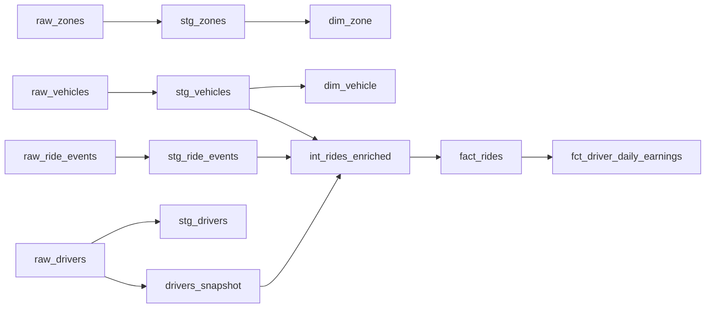

# InDrive Analytics with dbt

An analytics pipeline for a ride-hailing app (InDrive-style), built with **dbt**, **Postgres** and **Docker**.

It takes four raw CSV files (drivers, vehicles, zones, ride events) and turns them into a tested **star schema** that is ready for analysis.

## What this project shows

- **Sources and freshness checks** on the raw tables
- **Staging layer**: one clean model per raw table (renaming and typing only)
- **Star schema**: two dimensions (`dim_vehicle`, `dim_zone`) and an **incremental** fact table (`fact_rides`, merge strategy)
- **Snapshot (SCD Type 2)** to track changes in driver ratings over time
- **Ephemeral intermediate model** that joins rides with the current driver version and their vehicle
- **Macro** that classifies a rating into a bucket, and a **project variable** (`start_date`)
- **12 data tests**: `unique`, `not_null`, `accepted_values`, `relationships`
- **Window functions**: cumulative earnings and daily ranking per driver
- **Generated documentation** with a lineage graph (`dbt docs`)

## Data flow



| Layer | Models | Materialization |
|---|---|---|
| Staging | `stg_drivers`, `stg_vehicles`, `stg_zones`, `stg_ride_events` | view |
| Snapshot | `drivers_snapshot` | snapshot (SCD Type 2) |
| Intermediate | `int_rides_enriched` | ephemeral |
| Marts | `dim_vehicle`, `dim_zone`, `fact_rides`, `fct_driver_daily_earnings` | table / incremental |

## Project structure

```
indrive_dbt/
├── docker-compose.yml        # Postgres + Adminer
└── dbt_project/
    ├── dbt_project.yml
    ├── profiles.yml.example
    ├── macros/               # rating_bucket, generate_schema_name
    ├── models/
    │   ├── staging/
    │   ├── intermediate/
    │   └── marts/
    ├── seeds/                # the 4 raw CSV files
    └── snapshots/            # drivers_snapshot
```

## How to run it

**Requirements:** Docker, and Python 3.12 (dbt did not work with Python 3.14 when I tried).

1. **Start the database**
   ```bash
   docker compose up -d
   ```
   Postgres runs on port **5433** (I changed it from 5432 to avoid a conflict with another Postgres on my machine). Adminer is available at http://localhost:8082 (system: PostgreSQL, server: `postgres`, user/password: `indrive`, database: `indrive_warehouse`).

2. **Install dbt**
   ```bash
   python -m venv venv
   source venv/bin/activate        # on Windows: .\venv\Scripts\Activate.ps1
   pip install dbt-postgres
   ```

3. **Configure the connection.** Copy `dbt_project/profiles.yml.example` to `~/.dbt/profiles.yml` and set `port: 5433`.

4. **Build and test**
   ```bash
   cd dbt_project
   dbt debug
   dbt seed
   dbt snapshot
   dbt run
   dbt test
   ```
   Expected result: `dbt run` with `PASS=8 ERROR=0` and `dbt test` with `PASS=12 ERROR=0`.

5. **Browse the documentation**
   ```bash
   dbt docs generate
   dbt docs serve --port 8085
   ```

## Design decisions and what I learned

### Grain of `fact_rides`
One row = one ride (`ride_id`). I checked that `ride_id` is unique (407 rows, 407 distinct ids).

### Why SCD Type 1 for `dim_vehicle` and `dim_zone`
A vehicle or a zone almost never changes. If something changes, replacing the old value is enough, because no analysis needs the old one.

### Why a snapshot for driver ratings
A driver's rating changes often (for example from 4.8 to 3.9). I want to keep the old and the new rating to see how it evolved. The snapshot does exactly that, with validity dates. For a vehicle or a zone there is nothing to track over time, so a snapshot would be useless.

### Why a LEFT JOIN and not an INNER JOIN
With a `LEFT JOIN`, every ride is kept, even if the driver does not exist. Then the `relationships` test can see the problem and fail. With an `INNER JOIN`, a ride with an unknown driver would disappear silently, the test would stay green, and the error would stay hidden. I want `dbt test` to be the quality gate, not a filter hidden inside a join.

### Macro or variable for the rating buckets
A macro. Classifying a rating (below 4.5, 4.5 to 4.8, above 4.8) is a rule applied to every row. A variable only stores a simple value, like `start_date`, and cannot hold a rule.

### Incremental models and old rows
I changed driver 1's rating and looked at their 57 rides in `fact_rides`:

| Moment | Rating in `fact_rides` |
|---|---|
| Before the change | 4.80 |
| After `dbt snapshot` and a normal `dbt run` | 4.80 |
| After `dbt run --full-refresh` | 3.90 |

`fact_rides` is incremental: dbt only adds new rides and does not touch old ones, so their rating stays frozen. `--full-refresh` drops and rebuilds the whole table with the current snapshot version.

### Testing with a bad row
I inserted a ride with a driver that does not exist (`driver_id = 999`). Only one test failed: the `relationships` test between `fact_rides.driver_id` and `stg_drivers.driver_id`. The other tests passed because the ride had valid zones and a unique `ride_id`. This works thanks to the `LEFT JOIN`: the ride did not disappear, so the test caught it. I then removed the ride and rebuilt `fact_rides` with `--full-refresh`.

### An ephemeral model in the lineage graph
`int_rides_enriched` appears in the lineage graph even though no table with this name exists in the database. dbt builds the graph by reading my project files and `ref()` calls, not by looking at what exists in Postgres. An ephemeral model is never created in the database: its code is copied into `fact_rides`. It is still part of the project, so dbt shows it.

## Proof that it runs

- `dbt run`: `PASS=8 WARN=0 ERROR=0`
- `dbt test`: `PASS=12 WARN=0 ERROR=0`

## Notes

- `dbt source freshness` reports an error on `raw_ride_events`. This is expected: the sample rides are from September 2026, so the table is older than the 7-day threshold.
- `dbt run` does not execute snapshots. Run `dbt snapshot` before `dbt run`, because `int_rides_enriched` reads `drivers_snapshot`.

## Tech stack

dbt Core · PostgreSQL 16 · Docker · Adminer · Python 3.12
